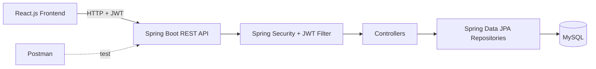
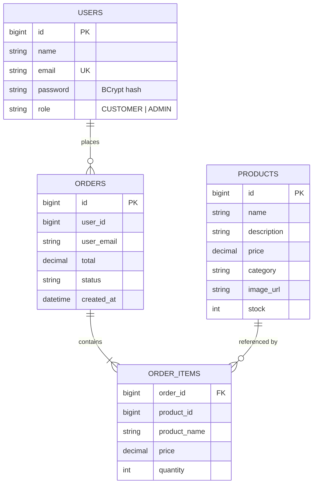

<div align="center">

# 🛍️ CartNova — Online Shopping Application

**A full-stack e-commerce project with product browsing, cart & checkout, order history, JWT login with role-based access, and a separate admin panel.**


[Live Demo](#-live-demo) · [Features](#-features) · [Tech Stack](#-tech-stack) · [Getting Started](#-getting-started) · [API Reference](#-api-reference) · [Roadmap](#-roadmap)

</div>

---

## 📌 Table of Contents

1. [About the Project](#-about-the-project)
2. [Live Demo](#-live-demo)
3. [Features](#-features)
4. [Tech Stack](#-tech-stack)
5. [Architecture](#-architecture)
6. [Project Structure](#-project-structure)
7. [Database Design](#-database-design)
8. [Getting Started](#-getting-started)
9. [Default Accounts](#-default-accounts)
10. [API Reference](#-api-reference)
11. [Authentication & Roles (JWT)](#-authentication--roles-jwt)
12. [Testing with Postman](#-testing-with-postman)
13. [Deployment](#-deployment)
14. [Troubleshooting](#-troubleshooting)
15. [Roadmap](#-roadmap)
16. [What I Learned](#-what-i-learned)
17. [License](#-license)

---

## 📖 About the Project

**CartNova** is an online shopping application where customers can browse products, search and filter by category, view product details, add items to a cart, place orders and track their order history. A separate **admin panel** lets the store owner manage products, stock and orders.

The backend is a **Spring Boot REST API** that stores data in **MySQL** through **Spring Data JPA**. Security is handled with **JWT** tokens and **role-based access control** (`CUSTOMER` and `ADMIN`). The frontend is built with **React.js**. All APIs can be tested with **Postman**.

This repository contains **three parts**:

| Folder | What it is |
|---|---|
| [`backend/`](backend) | Spring Boot + Spring Data JPA + MySQL + JWT REST API (starter implementation) |
| [`frontend/`](frontend) | React.js (Vite) client that talks to the backend (starter implementation) |
| [`demo/`](demo) | A **static, ready-to-deploy demo** (HTML/CSS/JS) with a richer UI — works without any backend. Built for Netlify |

> 🧪 **Note:** The `demo/` version is a **front-end only demo project**. It uses the free [DummyJSON](https://dummyjson.com) API for products and stores carts/orders in the browser's `localStorage`. No real payments, orders or deliveries happen. The `backend/` + `frontend/` folders are the full-stack version described in the rest of this README.

---

## 🌐 Live Demo

Deploy the `demo/` folder to Netlify (see [Deployment](#-deployment)) and put your link here:

```
https://cart-nova-online.netlify.app/
```

**Demo logins** (for the `demo/` version): Customer `emilys` / `emilyspass` · Admin `admin` / `admin123`

**What the demo shows:** Flipkart/Meesho-style home with auto-sliding banners and product carousels, category strip, live search with suggestions, filters and sorting, product detail popup with gallery and reviews, wishlist, cart drawer with coupons, 3-step checkout, saved delivery addresses, order success animation, live order tracking, and an admin dashboard.

---

## ✨ Features

### 👤 Customer
- 🔍 **Product catalog** with search by name and category filters
- 📄 **Product detail** view (image, description, price, stock)
- 🛒 **Shopping cart** — add, remove, change quantity
- 💳 **Checkout** — places an order and reduces stock automatically
- 📦 **Order history** — each user sees only their own orders with status
- 🔐 **Register / Login** with JWT

### 🛠️ Admin
- ➕ **Add, edit and delete products**
- 📊 **Manage stock** quantity per product
- 🧾 **View all orders** and update status (`PLACED → PACKED → SHIPPED → DELIVERED / CANCELLED`)
- 🔒 Admin APIs are protected — customers get `403 Forbidden`

### 🔐 Security
- Passwords hashed with **BCrypt**
- **Stateless JWT** authentication (no server sessions)
- **Role-based authorization** (`/api/admin/**` → `ADMIN` only)
- Stock is validated and updated inside a **database transaction** (rolls back on error)

---

## 🧰 Tech Stack

| Layer | Technology | Purpose |
|---|---|---|
| Frontend | **React.js 18** (Vite), React Router | UI, routing, API calls |
| Backend | **Java 17**, **Spring Boot 3.2** | REST API |
| Security | **Spring Security**, **JWT (jjwt)**, BCrypt | Authentication & role-based access |
| Data access | **Spring Data JPA** (Hibernate) | ORM / repositories |
| Database | **MySQL 8** | Persistent storage |
| API testing | **Postman** | Collection included in `/postman` |
| Build tools | Maven, npm | Build & dependency management |
| DevOps | Docker Compose (MySQL), Netlify (demo) | Local DB and hosting |

**Demo version only:** HTML5, CSS3, vanilla JavaScript (ES6), DummyJSON REST API, `localStorage`, Canvas / Web Audio / Web Speech browser APIs.

---

## 🏗️ Architecture



**Request flow**

1. User logs in → backend verifies BCrypt password → returns a **JWT** containing email + role.
2. React stores the token and sends `Authorization: Bearer <token>` on every request.
3. `JwtFilter` validates the token and sets the user + role in Spring's security context.
4. `SecurityConfig` rules decide who can reach which endpoint.
5. Controllers use JPA repositories to read/write MySQL.

---

## 📁 Project Structure

```
CartNova/
├── README.md
├── LICENSE
├── .gitignore
├── docker-compose.yml            # local MySQL
├── database/
│   └── schema.sql                # reference SQL schema
├── postman/
│   └── CartNova.postman_collection.json
├── backend/                      # Spring Boot API
│   ├── pom.xml
│   └── src/main/
│       ├── resources/application.properties
│       └── java/com/cartnova/
│           ├── CartNovaApplication.java
│           ├── config/DataSeeder.java        # demo users + products
│           ├── model/                        # User, Product, Order, OrderItem
│           ├── repository/                   # Spring Data JPA interfaces
│           ├── security/                     # JwtUtil, JwtFilter, SecurityConfig
│           └── controller/                   # Auth, Product, Order, Admin
├── frontend/                     # React (Vite)
│   ├── package.json
│   ├── vite.config.js
│   └── src/
│       ├── App.jsx, api.js, main.jsx, styles.css
│       └── pages/                # Products, Cart, Orders, Login, Admin
└── demo/                         # static Netlify demo (index.html)
```

---

## 🗄️ Database Design



Tables are created automatically by Hibernate (`spring.jpa.hibernate.ddl-auto=update`). A reference script is in [`database/schema.sql`](database/schema.sql).

---

## 🚀 Getting Started

### Prerequisites

| Tool | Version |
|---|---|
| Java JDK | 17+ |
| Maven | 3.8+ |
| Node.js | 18+ |
| MySQL | 8+ (or Docker) |
| Postman | optional |

### Option A — Just see the demo (no setup)

Open `demo/index.html` in your browser, or deploy the `demo/` folder to Netlify. No backend needed.

### Option B — Full stack

**1) Clone**

```bash
git clone https://github.com/<your-username>/CartNova.git
cd CartNova
```

**2) Start MySQL** (pick one)

```bash
# with Docker
docker compose up -d
```
or install MySQL yourself — the app creates the `cartnova` database automatically.

**3) Run the backend**

```bash
cd backend
# if your MySQL user/password are not root/root:
#   export DB_USER=youruser DB_PASS=yourpass        (Windows: set DB_USER=...)
mvn spring-boot:run
```

The API starts on **http://localhost:8080**. On first start, demo users and products are inserted automatically.

**4) Run the frontend**

```bash
cd frontend
npm install
npm run dev
```

Open **http://localhost:5173**. Vite proxies `/api` calls to `localhost:8080`.

### Configuration

`backend/src/main/resources/application.properties`

| Property | Default | Meaning |
|---|---|---|
| `server.port` | `8080` | API port |
| `spring.datasource.url` | `jdbc:mysql://localhost:3306/cartnova` | MySQL URL |
| `spring.datasource.username` / `password` | `root` / `root` | via `DB_USER` / `DB_PASS` env vars |
| `jwt.secret` | demo value | **Change in production** via `JWT_SECRET` (32+ chars) |
| `jwt.expiration-ms` | `86400000` | Token lifetime (24 h) |

---

## 🔑 Default Accounts

Created automatically by `DataSeeder` on first run:

| Role | Email | Password |
|---|---|---|
| ADMIN | `admin@cartnova.com` | `admin123` |
| CUSTOMER | `user@cartnova.com` | `user123` |

> ⚠️ Demo credentials only. Change or remove them before any real deployment.

---

## 📡 API Reference

Base URL: `http://localhost:8080`

### Auth (public)

| Method | Endpoint | Body | Description |
|---|---|---|---|
| POST | `/api/auth/register` | `{name, email, password}` | Create a CUSTOMER account → returns JWT |
| POST | `/api/auth/login` | `{email, password}` | Login → returns `{token, name, email, role}` |

### Products

| Method | Endpoint | Access | Description |
|---|---|---|---|
| GET | `/api/products?q=&category=` | Public | List / search / filter |
| GET | `/api/products/categories` | Public | All categories |
| GET | `/api/products/{id}` | Public | Product detail |

### Orders (logged-in user)

| Method | Endpoint | Description |
|---|---|---|
| POST | `/api/orders` | Place order `{items:[{productId, quantity}]}` — validates & reduces stock |
| GET | `/api/orders/my` | Current user's order history |

### Admin (`ROLE_ADMIN` only)

| Method | Endpoint | Description |
|---|---|---|
| POST | `/api/admin/products` | Create product |
| PUT | `/api/admin/products/{id}` | Update product |
| PATCH | `/api/admin/products/{id}/stock?stock=` | Update stock |
| DELETE | `/api/admin/products/{id}` | Delete product |
| GET | `/api/admin/orders` | All orders |
| PATCH | `/api/admin/orders/{id}/status?status=` | `PLACED / PACKED / SHIPPED / DELIVERED / CANCELLED` |

### Example requests

```bash
# Login
curl -X POST http://localhost:8080/api/auth/login \
  -H "Content-Type: application/json" \
  -d '{"email":"user@cartnova.com","password":"user123"}'

# Search products
curl "http://localhost:8080/api/products?q=shoe&category=Fashion"

# Place an order (use the token from login)
curl -X POST http://localhost:8080/api/orders \
  -H "Authorization: Bearer <TOKEN>" -H "Content-Type: application/json" \
  -d '{"items":[{"productId":1,"quantity":2}]}'
```

### Status codes

| Code | Meaning |
|---|---|
| 200 | Success |
| 400 | Bad request (invalid item, not enough stock, duplicate email) |
| 401 | Missing / invalid token or wrong login |
| 403 | Logged in but not allowed (e.g. customer calling admin API) |
| 404 | Not found |

---

## 🔐 Authentication & Roles (JWT)

```
POST /api/auth/login ──► verify BCrypt password ──► JwtUtil.generate(email, role)
                                                       │
        Authorization: Bearer <token>  ◄───────────────┘
                     │
                     ▼
              JwtFilter ──► parse token ──► SecurityContext (user + ROLE_xxx)
                     │
                     ▼
        SecurityConfig rules
          /api/auth/**              → public
          GET /api/products/**      → public
          /api/admin/**             → ROLE_ADMIN
          everything else           → authenticated
```

A JWT has three parts (`header.payload.signature`). The payload carries the user's email (`sub`), `role`, issue time and expiry. Paste a token into [jwt.io](https://jwt.io) to inspect it.

---

## 📮 Testing with Postman

1. Open Postman → **Import** → select `postman/CartNova.postman_collection.json`.
2. Make sure the backend is running on `http://localhost:8080` (variable `baseUrl`).
3. Run **Auth → Login (Customer)** or **Login (Admin)** — the test script saves the JWT into the `{{token}}` variable automatically.
4. Run the other requests — protected ones already use `Bearer {{token}}`.
5. Try **Admin** requests with the *customer* token to see `403 Forbidden`.

---

## ☁️ Deployment

### Demo (Netlify)

1. Go to [app.netlify.com/drop](https://app.netlify.com/drop).
2. Drag the **`demo/`** folder onto the page. Done — you get a live URL.

Or connect the GitHub repo in Netlify and set **Base directory / Publish directory** to `demo`.

### Full stack (suggested)

| Part | Where |
|---|---|
| React frontend | Netlify / Vercel (`npm run build`, publish `dist`, set `VITE_API_URL`) |
| Spring Boot API | Render / Railway / AWS (`mvn package`, run the jar) |
| MySQL | Railway / Aiven / AWS RDS — set `DB_USER`, `DB_PASS` and the datasource URL |

Production checklist: set a strong `JWT_SECRET`, restrict CORS in `SecurityConfig`, remove demo accounts, use HTTPS.

---

## 🩺 Troubleshooting

| Problem | Fix |
|---|---|
| `Access denied for user 'root'` | Set `DB_USER` / `DB_PASS` to match your MySQL |
| `Communications link failure` | MySQL isn't running — `docker compose up -d` |
| `Port 8080 already in use` | Change `server.port` or stop the other app |
| Frontend shows no products | Backend not running or proxy port mismatch |
| `401 Unauthorized` | Login again; token missing or expired |
| `403 Forbidden` on admin APIs | You're using a CUSTOMER token — login as admin |
| `Weak key` JWT error | `jwt.secret` must be 32+ characters |
| Netlify page refresh gives 404 | Keep the `_redirects` file inside `demo/` |

---

## 🗺️ Roadmap

- [x] Product catalog, search, category filter
- [x] Cart and checkout with stock validation
- [x] JWT login with customer/admin roles
- [x] Admin: products, stock, orders
- [x] Postman collection
- [ ] Pagination and sorting in the API
- [ ] Product images upload
- [ ] Ratings and reviews
- [ ] Saved addresses in the backend (currently in the demo)
- [ ] Online payment (Razorpay / Stripe test mode)
- [ ] Email notifications
- [ ] Unit and integration tests (JUnit, Mockito)
- [ ] Swagger / OpenAPI docs
- [ ] Docker image for the whole stack

---

## 🎓 What I Learned

- Designing a REST API with **Spring Boot** and layering controllers / repositories / models
- Mapping entities to MySQL with **Spring Data JPA** and handling transactions
- Implementing **JWT authentication** and **role-based authorization** with Spring Security
- Building a **React** client that stores tokens and calls a secured API
- Testing and documenting APIs with **Postman**
- Deploying a static front end on **Netlify**

---

## 📝 Resume Description

> **CartNova – Online Shopping Application** | React.js, Spring Boot, Java, MySQL, Spring Data JPA, JWT, Postman
> - Built a full-stack shopping app with product search, category filters, cart, checkout and per-user order history.
> - Implemented JWT login with role-based access for customer and admin using Spring Security.
> - Developed an admin panel to manage products, stock and orders through Spring Boot REST APIs backed by MySQL.
> - Tested all endpoints with Postman and deployed a front-end demo on Netlify.

---

## 📜 License

Distributed under the **MIT License**. See [`LICENSE`](LICENSE) for details.

<div align="center">

⭐ If you like this project, give it a star!

*This is a demonstration / learning project. No real products are sold or shipped.*

</div>
